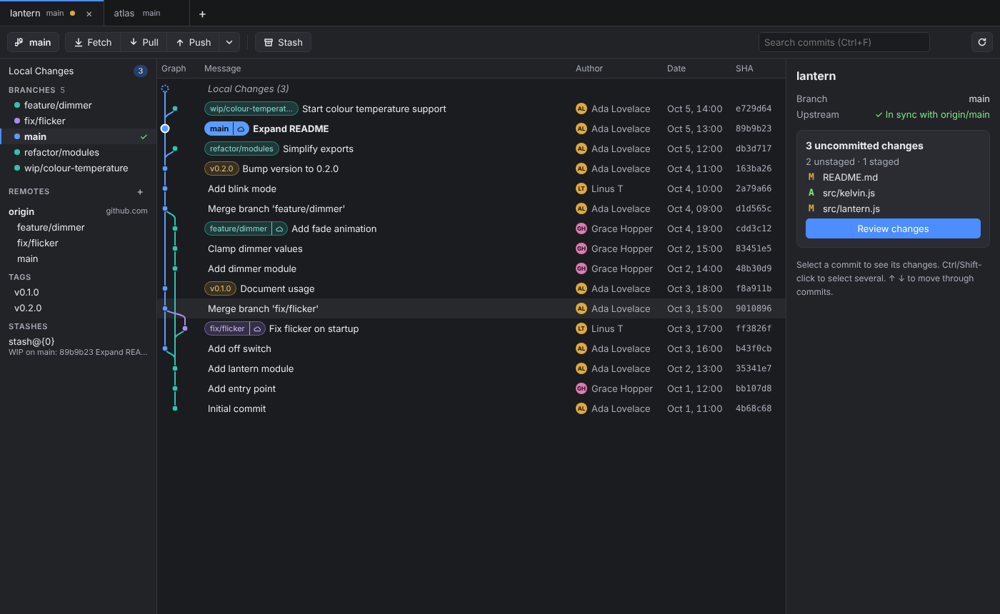
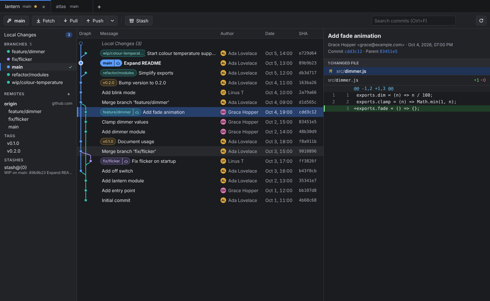
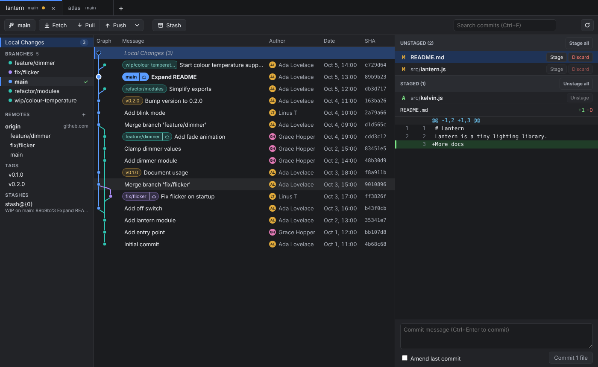

# Forklin

A local-only Git client for Ubuntu, in the spirit of Fork. It shells out to your system `git`, keeps no accounts and sends no telemetry.

**[Documentation and user guide](https://smistry7.github.io/forklin/)**

## Features

- **Commit graph** with lanes, branch/tag/remote badges (a branch and its remote twin share one pill), a dashed "Local Changes" node, lazy loading of long histories.
- **Search** the loaded history by message, author, hash or ref name: Ctrl+F, then Enter / Shift+Enter to step through matches.
- **Tabs for multiple repos**: drag to reorder, restored on restart, Ctrl+T open, Ctrl+W close, Ctrl+Tab / Ctrl+1..9 switch. (Cmd works in place of Ctrl on macOS.)
- **Rebase onto here**: right-click any commit, "Rebase <current branch> onto here". Uncommitted changes are autostashed. Conflicts show a banner with Continue / Skip / Abort.
- **Multi-select + squash**: Ctrl/Shift-click commits, right-click, "Squash N commits…". Must be consecutive, merge-free commits on the current branch. "Squash into parent…" works on one commit or a consecutive selection and folds it into the commit below, with a message prompt to reword the result.
- **Manage remotes**: the sidebar's Remotes section lists each remote with its URL and branches. "+" adds one; right-click a remote to edit its name/URL or remove it.
- **Prune gone branches**: after a fetch, local branches whose upstream was deleted on the remote show "gone". The ✂ button on the sidebar's Branches header lists them and deletes them all (never the checked-out branch).
- Also: checkout, create branch/tag, delete tag (locally and on remotes), merge, cherry-pick, revert, reset (soft/mixed/hard), stash, stage/unstage/discard, commit/amend, fetch/pull/push with ahead/behind counts (force push with lease is in the menu next to Push), diffs with line numbers.
- **Repository overview** in the details pane when nothing is selected: branch, upstream status and a summary of uncommitted changes.
- Changes made outside the app (terminal commits, etc.) refresh automatically.

## Screenshots

## Install

### AppImage (easiest, no Node.js needed)

Download `forklin-<version>-x86_64.AppImage` from the [Releases page](https://github.com/smistry7/forklin/releases/latest), then:

    chmod +x forklin-*.AppImage
    ./forklin-*.AppImage /path/to/repo

You need `git` 2.25 or newer installed. On Ubuntu 22.04+ the AppImage may also need FUSE 2: `sudo apt install libfuse2` (`libfuse2t64` on 24.04). Tools like [AppImageLauncher](https://github.com/TheAssassin/AppImageLauncher) can add it to your app grid.

### From a source tarball

Requirements: Linux (developed on Ubuntu 20.04+), `git` 2.25 or newer, and a current [Node.js](https://nodejs.org) with npm (apt's version is often too old; [nvm](https://github.com/nvm-sh/nvm) works well).

Download `forklin-<version>.tar.gz` from the Releases page, then:

    tar xzf forklin-*.tar.gz
    cd forklin-*/
    scripts/install-desktop.sh   # npm install + app-grid entry + `forklin` command

Or install from source:

    git clone https://github.com/smistry7/forklin.git
    cd forklin
    scripts/install-desktop.sh

The installer links the checkout into `~/.local/bin/forklin` and adds an app-grid entry, so keep the folder where it is. Make sure `~/.local/bin` is on your `PATH`. Then run `forklin /path/to/repo` or launch it from your app grid.

To run without installing a launcher:

    npm install
    npm start                 # or: bin/forklin /path/to/repo

`--no-sandbox` is passed because the npm-installed Electron has no setuid sandbox helper. Remove it if you set that up. `--no-zygote` is passed because Chromium's zygote helper crashes at startup on some machines (window never opens, log ends in "GPU process isn't usable").

## Develop

    npm run dist:linux   # build dist/*.AppImage
    npm test    # graph layout, renderer logic and real-git integration tests (needs git; tested on 2.25)
    xvfb-run -a npm run test:e2e   # UI smoke test against the real app (needs a display)

- `src/main/git.js`: all git commands (no shell, refs starting with `-` rejected)
- `src/renderer/graph.js`: lane layout (pure, unit-tested)
- `src/renderer/logic.js`: other pure renderer logic (ref pills, diff parsing, search, squash checks), unit-tested
- `src/renderer/app.js`: UI (plain DOM); `styles.css` holds the theme tokens
- `e2e/smoke.js`: drives the real app against a throwaway repo
- `scripts/screenshots/`: regenerates the images in `docs/images` (`xvfb-run -a npm run screenshots`)
- `docs/`: the [GitHub Pages site](https://smistry7.github.io/forklin/), deployed by `.github/workflows/pages.yml`

See [CONTRIBUTING.md](CONTRIBUTING.md) and [SECURITY.md](SECURITY.md).

## License

[MIT](LICENSE)
